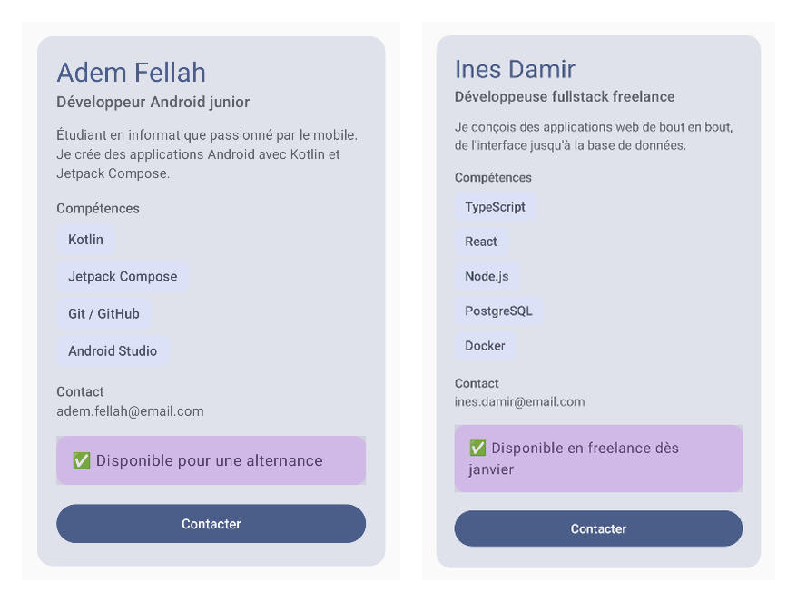

# Profil développeur Compose

## Description

Cette application Android affiche une fiche « Profil développeur », réalisée avec Jetpack Compose.
L'écran présente le nom, le rôle, une courte description, une liste de compétences, un contact et la disponibilité d'un développeur.
Deux actions sont proposées : un bouton « Contacter » et une zone cliquable qui indique la disponibilité.
Les clics appellent des fonctions vides : les composants signalent l'événement, mais ne contiennent aucune logique applicative.
L'interface est découpée en composables réutilisables, qui reçoivent leurs données en paramètres.

## Notions utilisées

- Fonctions composables (`@Composable`)
- Paramètres
- `Modifier` et chaînage de modifiers (`fillMaxWidth`, `padding`, `clickable`, `semantics`)
- Padding externe / padding interne
- Callbacks (`onClick`, `onContactClick`, `onAvailabilityClick`)
- `Scaffold` et `innerPadding`
- `Surface`, `Column`, `Text`, `Button`
- Thème généré du projet (`MaterialTheme`)
- Previews (`@Preview`)
- Accessibilité de base (`Role.Button`, `contentDescription`, `onClickLabel`)

## Explication courte

**1. Quels composables avez-vous créés ?**
`ProfileScreen`, `ProfileCard`, `ProfileHeader`, `SkillList`, `SkillItem`, `InfoLine`, `AvailabilityBadge`, `ContactButton`, ainsi que deux previews : `ProfileAndroidJuniorPreview` et `ProfileFullstackPreview`.

**2. Quel composable représente l'écran principal ?**
`ProfileScreen`. Il est appelé dans `MainActivity`, à l'intérieur du `Scaffold`.

**3. Où utilisez-vous un padding externe ?**
Dans `ProfileScreen`, le parent place la fiche avec `Modifier.fillMaxWidth().padding(16.dp)`, qu'il passe en paramètre `modifier` à `ProfileCard`.
Dans `ProfileCard`, les sections (`SkillList`, `InfoLine`, etc.) sont espacées entre elles avec `padding(top = 16.dp)`, que le parent leur transmet.
Dans `SkillList`, chaque `SkillItem` reçoit `padding(top = 6.dp)`.

**4. Où utilisez-vous un padding interne ?**
Dans `ProfileCard`, la `Column` interne utilise `padding(20.dp)` pour éloigner le contenu des bords de la fiche.
Dans `SkillItem`, le texte a un padding de 12 × 6 dp à l'intérieur de son étiquette.
Dans `AvailabilityBadge`, le texte a un padding de 16 dp.

**5. Quel composant reçoit un callback ?**
`ContactButton` (`onClick`), `AvailabilityBadge` (`onClick`), et `ProfileScreen` / `ProfileCard`, qui reçoivent `onContactClick` et `onAvailabilityClick` et les transmettent aux composants enfants.
Dans `MainActivity`, ces callbacks appellent des fonctions vides commentées (`contacter()` et `afficherDisponibilite()`).

**6. Quelle information d'accessibilité avez-vous ajoutée ?**
La zone personnalisée `AvailabilityBadge` est déclarée avec `clickable(role = Role.Button, onClickLabel = "Voir les détails de la disponibilité")`.
Elle reçoit aussi un `contentDescription` grâce à `semantics`.
Un lecteur d'écran l'annonce donc comme un bouton et explique l'action.
Le `ContactButton` utilise un `Button` Material : ce composant est déjà reconnu comme un bouton par l'accessibilité, ce qui le rend plus explicite qu'une simple zone cliquable.

**7. Pourquoi vos composants peuvent-ils être considérés comme réutilisables ?**
Ils ne contiennent aucune donnée « en dur » : le nom, le rôle, les compétences, les textes et les callbacks sont passés en paramètres.
Chacun accepte aussi un `modifier: Modifier = Modifier`, ce qui permet au parent de décider de son placement.
Les deux previews le prouvent : le même `ProfileScreen` affiche deux profils différents (Android junior et fullstack).

## Capture d'écran

